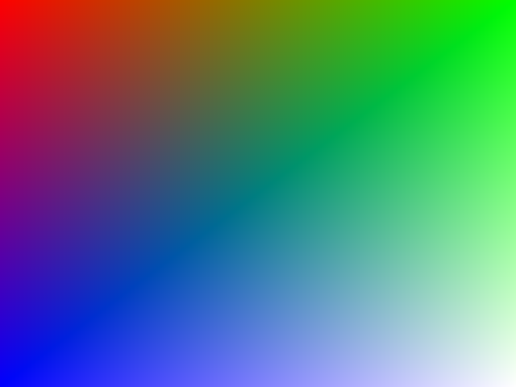

# MiniGPU · CPU → CUDA Rasterizer

从零实现的 CPU 软件光栅器，目标是在不依赖 OpenGL / Vulkan / DirectX 的前提下，把同一套坐标、覆盖和深度规则迁移到 CUDA，并用确定性测试量化 CPU 与 GPU 的差异。

**当前进度：CPU 基线主体完成（原计划 Lab01–04；OBJ loader 为有意收窄的三角形子集）；CUDA 后端尚未实现。** 本 README 将「已验证的能力」和「路线图」分开写，不把计划当成结果。

`C++17` · `CMake 3.18+` · 标准库之外无依赖 · CPU golden 自检 100/100 · 常规测试 11/11 · CUDA ⬜

## 项目简介

MiniGPU 是一个纯 C++17 的软件光栅器：顶点变换、齐次裁剪判定、透视除法、viewport、三角形光栅化、Z-buffer、OBJ 解析和 PPM 输出都在仓库内实现，没有调用图形 API，也没有引入第三方数学或图像库。

当前版本可以独立完成「加载 OBJ → 变换 → 裁剪 → 光栅化 → 深度测试 → 输出图片」的完整 CPU 路径。CUDA 阶段尚未开始，`cuda-naive` / `cuda-tiled` 会明确报错，而不是悄悄输出空图。

## 当前进度

按项目原计划的 10 个 milestone，前 4 个的主线已完成（OBJ loader 为三角形子集，见[已知限制](#已知限制)）：

| 模块 | 状态 | 说明 / 验证方式 |
| --- | :---: | --- |
| 数学与坐标契约 | ✅ | 列主序 4×4 矩阵、左手系 look-at、透视投影、旋转 / 缩放 / 平移；单元测试覆盖非法输入 |
| CPU 光栅化 | ✅ | 包围盒 + 边函数 + top-left 规则；扫描线填充；两种实现共享着色与深度路径 |
| 三维管线 | ✅ | `clip = P * V * M * p`、`-w ≤ x,y,z ≤ w` 裁剪判定、透视除法、viewport、深度 `[0,1]` |
| Z-buffer | ✅ | 严格小于才写入；严格等深保留先提交者；遮挡、相交平面、等深与清屏均有测试 |
| 模型输入 | ✅ | 最小 OBJ loader；硬编码 cube；连续屏幕三角形缓冲 |
| 统一渲染入口 | ✅ | `RenderEntry` 负责校验、场景准备、MVP、调度和文件输出；后端可注入 |
| 确定性 golden 对比 | ✅ | 固定种子 1027、100 组随机 OBJ；CPU 自检 100/100 |
| Naive CUDA | ⬜ | 未实现；当前占位会返回明确错误 |
| Tiled CUDA | ⬜ | 未实现；设计目标为 CPU binning + 16×16 tile + GPU 光栅化 |
| Benchmark / Nsight | ⬜ | 依赖 CUDA 阶段，尚无性能数字 |

本轮验证环境：Ubuntu 24.04、GCC 13.3、CMake 3.28.3、Release。Windows / MSVC 的构建命令保留在下方，构建脚本已处理 MSVC 的 UTF-8 源码解析问题。

## 演示

以下图片由当前 CPU 后端实际渲染，不是概念图：

| Cube（MVP + Z-buffer） | 三角形插值 | OBJ 加载 |
| --- | --- | --- |
|  |  |  |
| `--angle 30` 的 cube；Z-buffer 保证近侧面覆盖远侧面 | 两个三角形通过包围盒光栅化拼成整屏，共享边颜色连续 | `assets/cube.obj` 经 loader、MVP 和 perspective divide 后渲染 |

复现演示图：

```sh
cmake -S . -B build -DCMAKE_BUILD_TYPE=Release
cmake --build build -j"$(nproc)"

./build/minigpu --backend cpu --scene cube --angle 30 --scale 1 1 1 \
  --width 640 --height 640 --output cube.ppm
./build/minigpu --backend cpu --scene triangles \
  --width 640 --height 480 --output triangles.ppm
./build/minigpu --backend cpu --obj assets/cube.obj --angle 30 --scale 1 1 1 \
  --width 640 --height 640 --output obj.ppm
```

PPM 是刻意选择的零依赖输出格式；`docs/images/` 中的 PNG 由这些 PPM 转换而来。

## 快速开始

需要 CMake 3.18+ 和支持 C++17 的编译器。CPU 路径不依赖 CUDA、窗口系统或第三方库。

### Linux / WSL

```sh
cmake -S . -B build -DCMAKE_BUILD_TYPE=Release
cmake --build build -j"$(nproc)"

# 常规测试：11/11 通过
ctest --test-dir build -LE golden --output-on-failure

# CPU golden 自检：比较器 + 清理流程，100/100 通过
./build/minigpu_golden_comparison_test --cpu --output-dir build/golden_cpu_check

# 渲染默认 cube
./build/minigpu --backend cpu --scene cube --angle 30 --width 256 --height 256 \
  --output cube.ppm
```

### Windows PowerShell（Visual Studio / MSVC）

```powershell
cmake -S . -B build -G "Visual Studio 17 2022"
cmake --build build --config Release
ctest --test-dir build -C Release -LE golden --output-on-failure
.\build\Release\minigpu_golden_comparison_test.exe --cpu --output-dir build\golden_cpu_check
.\build\Release\minigpu.exe --backend cpu --scene cube --angle 30 --output cube.ppm
```

Windows 与 WSL 可以共用源码，但必须使用不同的构建目录：CMake 缓存记录了系统路径、编译器和生成器。Visual Studio 生成器通过 `--config` / `-C` 指定配置，`CMAKE_BUILD_TYPE` 不控制它。

## 渲染管线

```text
main.cpp
  └─ RenderOptions
       └─ RenderEntry ── 参数校验 / 计算 MVP / 准备场景
            ├─ Cube 场景（硬编码 8 顶点、12 个索引三角形）
            └─ Loader → Mesh → build_screen_triangles
                                   │
                    TriangleBuffer（连续、POD、保序）
                                   │
                 ┌─────────────────┴──────────────────┐
                 │                                    │
          CpuRasterizer                      CUDA backend（规划中）
          └─ 包围盒 + 边函数 + top-left        ├─ cuda-naive：一线程一像素
                                               └─ cuda-tiled：16×16 tile
                 │
          Framebuffer（颜色 + 深度）→ PPM
```

关键步骤：

1. **场景输入**：硬编码 cube 或 OBJ 生成 `Mesh`（顶点 + 三角形索引）。
2. **主机端变换**：`M = T * (S * Ry)`，`MVP = P * V * M`；检查有限值、`w > 0` 和裁剪体边界，任一顶点越界则整三角形丢弃；随后透视除法、viewport 映射和深度映射。
3. **屏幕三角形缓冲**：每个顶点固定 16 字节（`x, y, z` + RGBA），三角形连续存放并保持输入顺序；同一份 `TriangleBuffer` 可直接 `memcpy` / `cudaMemcpy` 到设备。
4. **光栅化**：CPU 提供两种实现——包围盒 + 边函数 + top-left 规则，以及扫描线；二者共享颜色 / 深度插值和严格深度测试。
5. **输出**：`Framebuffer` 同时持有颜色和深度，写出 P6 PPM。

## 关键设计

| 设计点 | 当前实现 | 为什么这样做 |
| --- | --- | --- |
| 坐标契约 | 左手系、列向量、相机朝 +Z；NDC 各轴 `[-1,1]`；深度 `(ndc_z+1)/2`，近 0 远 1 | 先固定数学约定，再写 CPU / CUDA，避免两端「看起来都能画」但结果不可比 |
| 裁剪 | 不做完整齐次裁剪；任一顶点不满足 `-w ≤ x,y,z ≤ w` 就整三角形拒绝 | 以工时换取边界清晰、易测试的 MVP；代价是极端宽高比或贴近相机时边界可能缺面 |
| 覆盖规则 | 边函数 + top-left 规则；像素中心 `(x+0.5, y+0.5)` | 消除共享边裂缝和重复覆盖，并为 CUDA 保留同一判定 |
| 深度测试 | 严格小于才写入；严格等深保留先写入者 | 不依赖线程调度或提交顺序决定结果，GPU 阶段也按同一规则验收 |
| 顶点布局 | `ScreenVertex` = 16 字节、trivially copyable，`static_assert` 锁死 | 避免主机 / 设备结构体填充差异，上传时无需逐字段打包 |
| 后端注入 | `RenderEntry` 接收 `std::function<void(Framebuffer&, const RenderInput&)>` | CPU 与未来 CUDA 复用同一场景输入；测试可注入记录器，不依赖具体光栅器 |
| 确定性 | 固定种子、固定配色、保序缓冲、失败现场保留 | 让 golden 对比可重复，出错时能拿完整参数复现，而不是只看到一张差异图 |
| 错误处理 | 非法尺寸、索引、文件、非有限坐标、非法深度均抛出明确异常；CLI 返回非零退出码 | 正确性优先；不把「渲染出一张图」当作成功，也不吞掉 CUDA 错误 |

以下三个取舍值得在技术讨论中展开：

- **为什么先固定坐标契约，再写 CUDA？** 因为 CPU / GPU 结果不一致时，如果没有统一的 NDC、深度、viewport 和覆盖规则，就无法判断是变换错了、插值错了还是线程竞争。
- **为什么不用完整齐次裁剪？** 完整裁剪需要处理三角形与 6 个平面的交点、重建拓扑和属性插值，成本高；当前选择整三角形拒绝，并用测试覆盖非法 `w`、非有限变换和边界缺面，展示场景保持完整入镜。
- **为什么 golden 默认必须失败？** CUDA 未实现时，测试必须红。否则空输出、空对比或吞掉后端异常都会制造「通过」的假象。当前默认候选是显式不写像素的占位实现；实现 kernel 后再替换候选回调。

## 正确性验证

测试不是只跑通 demo，而是把接口契约写成断言。当前共 12 个 CTest 目标：

| 测试目标 | 覆盖内容 |
| --- | --- |
| `minigpu_smoke` | framebuffer 构造、越界、清屏、PPM 头与载荷 |
| `minigpu_framebuffer_test` | 尺寸、颜色、PPM 写入、异常路径 |
| `minigpu_math_test` | 向量 / 矩阵、乘法顺序、look-at、透视、旋转、非法输入 |
| `minigpu_raster_math_test` | 边函数恒等式、绕序、退化、top-left、重心坐标、包围盒、裁剪 |
| `minigpu_triangle_test` | 两种实现、6 种顶点排列、平边、退化、拼接无裂缝 / 不重复、固定像素插值、非有限坐标 |
| `minigpu_depth_test` | 前后顺序、混合实现、相交平面、等深、清屏、非法深度、cube 遮挡 |
| `minigpu_transform_test` | 裁剪边界包含性、`w ≤ 0` / NaN、近远面深度映射、viewport |
| `minigpu_triangle_buffer_test` | 16 字节布局、连续三角形、保序、平面配色、裁剪拒绝 |
| `minigpu_loader_test` | 合法 / 非法 OBJ、索引越界、扩展名、缺失文件、注释与顶点不足 |
| `minigpu_render_entry_test` | 场景分派、后端注入、文件输出 |
| `minigpu_golden_comparison_unit_test` | 比较器容差、失败产物保留、成功清理 |
| `minigpu_golden_comparison_test` | 100 组随机 OBJ 的 CPU golden 与候选后端对比（带 `golden` 标签） |

### 当前结果

```text
$ ctest --test-dir build -LE golden --output-on-failure
100% tests passed, 0 tests failed out of 11

$ ./build/minigpu_golden_comparison_test --cpu
Golden: 100/100 passed, 0 failed

$ ./build/minigpu_golden_comparison_test
Golden: 0/100 passed, 100 failed
```

最后一条是**有意的失败门禁**，不是回归：CUDA 未实现，默认候选是一个显式不写像素的占位后端，因此全量 `ctest` 会显示 1 个失败。`--cpu` 用来验证比较器、清理和失败报告本身工作正常；实现 CUDA 后，在 `tests/golden_comparison_test.cpp` 中替换候选回调即可。

### Golden 对比怎么工作

- 固定种子 `1027`，生成 100 组随机 OBJ：分辨率 96–160 × 64–128、FOV 55–80°、绕 Y 轴 ±45°、平移 ±0.2、缩放 0.7–1.2、50% 概率反转三角形提交顺序，每组 4–24 个三角形。
- 每组强制包含一个可见、非退化三角形，并检查 CPU 参考图确实有覆盖像素，防止「两张空图相等」造成假通过。
- CPU golden 与候选后端复用同一份 `RenderInput`；在内存中比较覆盖（深度是否有限）、RGB 每通道误差和深度绝对误差。
- 默认容差：RGB ≤ 1/255，深度 ≤ `1e-5`；背景深度按 `+inf` 处理。失败用例保留 OBJ 和 `report.txt`，其中包含种子、编号、误差统计和完整的 CPU 复现命令；成功用例立即删除，全部通过时删除本次运行目录。
- 默认输出目录 `golden_failures/` 已加入 Git 忽略规则，避免把失败现场误提交。

## CLI 参考

`./build/minigpu --help` 可查看完整用法。

| 参数 | 默认值 | 说明 |
| --- | --- | --- |
| `--backend` | `starter` | `starter` 只清屏；`cpu` 渲染；`cuda-naive` / `cuda-tiled` 当前明确报错 |
| `--scene` | `cube` | `cube`、`triangles`、`obj`；传 `--obj` 且未指定 `--scene` 时自动切到 `obj` |
| `--obj PATH` | — | OBJ 路径；目前只支持 CPU 后端 |
| `--output PATH` | `minigpu.ppm` | P6 PPM 输出路径 |
| `--width N` / `--height N` | `256` / `256` | 正整数像素尺寸 |
| `--angle DEGREES` | `30` | 绕 Y 轴旋转角度，单位度，支持负值 |
| `--reverse-order` | 关闭 | 反转 cube / OBJ 的三角形提交顺序，用于验证顺序无关性 |
| `--eye X Y Z` | `3 2 -6` | 相机世界坐标 |
| `--target X Y Z` | `0 0 0` | 世界空间注视点 |
| `--up X Y Z` | `0 1 0` | 相机参考上方向 |
| `--fov DEGREES` | `60` | 垂直视场角，范围 `(0,180)` |
| `--near N` | `0.1` | 近裁剪面距离 |
| `--far N` | `100` | 远裁剪面距离，要求 `0 < near < far` |
| `--translate X Y Z` | `0 0 0` | 模型世界空间平移 |
| `--scale X Y Z` | `1.5 1.1 0.7` | 模型各轴缩放倍率 |

所有数值必须有限；相机位置不能与注视点重合，up 不能为零或平行于视线。相机 / 模型参数目前只适用于 CPU 的 cube 和 obj 场景，传给 starter、triangles 或 CUDA 后端会明确报错。模型变换顺序为 `M = T * (S * Ry)`：先绕 Y 轴旋转，再缩放，最后平移。

```sh
./build/minigpu --backend cpu --obj assets/cube.obj \
  --eye 4 3 -8 --target 0 0 0 --up 0 1 0 \
  --fov 45 --near 0.1 --far 100 \
  --translate 0.5 0 0 --scale 1 1 1 --angle 30 --output custom.ppm
```

## 路线图

| 阶段 | 计划 | 完成标准 |
| --- | --- | --- |
| 5–6 · Naive CUDA | 设备分配 / 上传 / 释放、错误检查；每个线程一个像素，顺序遍历三角形并独占该像素颜色和深度 | cube、OBJ、非整 block 分辨率、遮挡和等深用例通过；golden 从 0/100 变为 100/100 |
| 7 · Benchmark | CUDA events 计时；warm-up 10 次、采样 ≥50 次，报告中位数和 p95；CSV 保留原始数据 | 覆盖 2 种分辨率 × 3 种三角形规模 × 3 种合法 block 配置；区分 H2D、kernel、D2H 和端到端 |
| 8 · 分析与设计 | Nsight Systems / Compute 代表性采样，定位一个真实瓶颈 | 给出「指标 → 代码位置 → 优化假设」的证据链，保留 naive 基线 |
| 9 · Tiled CUDA | CPU 生成三角形–tile 候选列表，GPU 每像素只遍历所属 tile；保留输入顺序保证等深一致 | 至少一个代表性场景稳定改善，同时报告回退场景；空 tile、边界、大三角形均有测试 |
| 10 · 交付 | 三后端一致性与性能复现、演示图片、最终报告 | 干净检出可构建、可测试、可复现；README 与性能报告回填实测值 |

CUDA 未实现前，不宣称 CUDA 或性能验收通过；没有实测数字时也不填估算值。

## 性能数据

CUDA 后端尚未实现，因此本 README **不提供** Raster time、端到端时间或加速比，避免用未测量的数字占位。

测量口径已在 [性能报告模板](docs/performance-report.md) 中固定：Release、同一场景 / 变换 / 输出规则、CPU 单线程基线、CUDA events、warm-up + ≥50 次采样、中位数 / p95、端到端包含 H2D / D2H 并排除 OBJ 磁盘解析与图片编码。CUDA 完成后会回填 CPU / Naive / Tiled 三组结果，并保留不利结果。

## 已知限制

- **CUDA 未实现**：`cuda-naive` 当前会报「CUDA 不可用」或 TODO；`cuda-tiled` 直接报 TODO。仓库没有可运行的 CUDA kernel，也没有 GPU 性能结论。
- **OBJ 子集**：只支持 `v x y z` 和三角形 `f i j k`；不支持 `v/vt/vn` 斜杠索引、负索引、四边形 / 多边形、材质、法线、UV 和顶点颜色。无顶点颜色时按三角形序号做确定性平面配色。
- **裁剪不完整**：任一顶点离开裁剪体就整三角形丢弃，不做逐平面裁剪；相机贴近物体或极端宽高比时可能出现缺面。展示场景保持完整入镜。
- **插值**：颜色和深度都在屏幕空间线性插值，尚未实现透视正确颜色插值；三个顶点的 alpha 必须相同，没有透明混合。
- **无背面剔除**：cube / OBJ 的背面也参与光栅化，由 Z-buffer 决定可见性；这对正确性演示足够，但不是最终性能路径。
- **CPU 单线程**：当前只有单线程基线，没有多线程、SIMD 或 benchmark 模块。
- **模型适配**：OBJ 需位于原点附近且尺寸接近自带 cube；不自动居中、归一化或缩放。
- **共享边的浮点细节**：严格等深时保留先提交者；但共享边两侧的深度由不同顶点组合插值，极少数边缘像素可能存在极小的浮点深度差，从而改变最终颜色。当前测试以 RGB ≤ 1、深度 ≤ `1e-5` 验收；CUDA 阶段会固定同一插值公式，并增加更大分辨率的差异回归。
- **尺寸上限**：光栅循环使用 `int32_t` 边界，宽高不能超过 `INT32_MAX`；超大分辨率还受内存限制。

纹理、材质、光照、交互窗口和通用场景图不在当前范围内。正确性、完整演示和可信测量优先于继续增加功能。

## 目录结构

```text
include/minigpu.hpp              公共头文件汇总
include/types.hpp                Color / Mesh / ScreenVertex / Triangle
include/math.hpp                 向量、矩阵、look-at、透视、旋转
include/raster_math.hpp          边函数、重心坐标、top-left、裁剪与 viewport
include/rasterizer.hpp           CPU 光栅器（包围盒 + 扫描线）
include/framebuffer.hpp          颜色 / 深度缓冲与 PPM 输出
include/triangle_buffer.hpp      连续屏幕三角形缓冲与上传布局契约
include/loader.hpp               最小 OBJ loader
include/render_entry.hpp         RenderOptions / RenderInput / 统一渲染入口
include/golden_comparison.hpp    golden 对比、容差、失败产物
include/scene.hpp                硬编码 cube 场景
include/cuda_backend.hpp         CUDA 入口声明

src/main.cpp                     CLI 参数解析与后端选择
src/render_entry.cpp             参数校验、场景准备、MVP、调度与输出
src/golden_comparison.cpp        固定种子 OBJ 生成、比较、报告与清理
src/rasterizer.cpp               CPU 光栅化、颜色插值、深度测试
src/raster_math.cpp              光栅数学与裁剪
src/triangle_buffer.cpp          Mesh → 屏幕三角形缓冲
src/loader.cpp                   OBJ 解析
src/framebuffer.cpp              缓冲与 PPM
src/math.cpp                     基础数学
src/scene.cpp                    cube 场景
src/cuda_backend.cu              CUDA 占位（TODO）

tests/                           12 个 CTest 目标
assets/cube.obj                  自带三角化 cube
docs/images/                     README 演示图
docs/performance-report.md       性能报告模板
docs/git-workflow.md             分支 / PR / 互审约定
labs/README.md                   各 milestone 的任务与验收
```

## 协作与文档

本项目为双人协作：A 负责数学 / MVP、顶点准备、CUDA kernel、分块与剔除；B 负责 framebuffer / CPU 光栅化、OBJ、正确性、benchmark 与 profiling。每周由模块负责人实现，另一人 review；共享接口变更先沟通，按 `分支 → 测试 → PR → 互审 → 合并` 推进。

- [各 milestone 任务与验收](labs/README.md)
- [双人 Git 简单约定](docs/git-workflow.md)
- [性能报告模板](docs/performance-report.md)

提交信息保持小步、可回溯；构建目录、临时 PPM 和 profiling 大文件不进入仓库。
